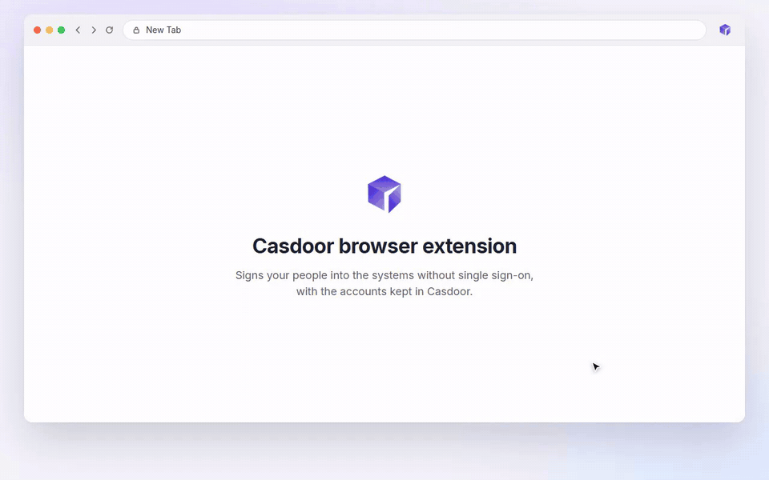

# Casdoor browser extension

English | [中文](README.zh-CN.md)

[](https://chromewebstore.google.com/detail/casdoor-browser-plugin/bnjbegmkpjbcpneclidlbloadenondlm)
[](https://github.com/casdoor/casdoor-chrome-extension/actions/workflows/release.yml)
[](LICENSE)

The Casdoor browser extension signs people into the systems that have no single sign-on, such as old OA, ERP and intranet sites, by filling their sign-in forms with the accounts kept in [Casdoor](https://casdoor.ai). The admin sets up each system once in Casdoor, the user signs in to Casdoor once in the extension, and from then on every sign-in page of those systems is filled and submitted for them.

[](docs/demo.mp4)

## What it does

- Fills the username and password of the system's sign-in page and signs in, when the admin turns on automatic submit.
- Works with server-side forms, single-page apps that render their sign-in late or route it with `#/login`, forms without a `<form>`, and sign-in boxes in frames. The fields are found automatically, or with CSS selectors set by the admin.
- Lets the user pick an account when they have more than one for a system, and uses that account next time.
- Reads simple image captchas with a model inside the extension, on the user's computer. A refused captcha is read again with a new picture, up to three times. A refused password is never tried again, so that the account doesn't get locked.
- Offers to save the account that the user signs in with by hand, so that it is filled next time, when the admin allows it.
- Fills a sign-in page that comes back within 30 seconds of an automatic sign-in without submitting it again, and says so.
- Shows the user's systems in its popup, opens them, and fills the current page on demand when automatic filling is turned off.
- Protects the sign-in pages of the systems: the browser doesn't offer to save the passwords there, and the developer tools are kept away from them as far as a page can.

## Install

Install it from the [Chrome Web Store](https://chromewebstore.google.com/detail/casdoor-browser-plugin/bnjbegmkpjbcpneclidlbloadenondlm). It works in Chrome 116 and later, and in Edge and other Chromium browsers that take extensions from the Chrome Web Store (in Edge, allow extensions from other stores when it asks).

Where the store can't be reached:

1. Download `casdoor-extension.zip` from the [latest release](https://github.com/casdoor/casdoor-chrome-extension/releases/latest) and unzip it into a folder that stays there, since the browser loads the extension from it every time it starts.
2. Open `chrome://extensions` (`edge://extensions` in Edge) and turn on **Developer mode**.
3. Click **Load unpacked** and pick the folder, the one with `manifest.json` in it.

The package has the public key of the store's extension in its manifest, so it gets the same ID and redirect URL wherever it's unzipped. Remove it before installing the extension from the store, the browser takes the two as the same extension. To update it, unzip the new release over the folder and click the reload button of the extension in `chrome://extensions`.

Pin the extension to the toolbar (the puzzle piece button, then the pin next to Casdoor) so its popup is one click away.

## Use it

### Sign in to Casdoor

Click the Casdoor button in the toolbar. Enter the **Casdoor server URL**, such as `https://door.example.com`, and the **Application** your admin gave you, then click **Sign in with Casdoor**. A Casdoor sign-in window opens; sign in there as you always do, with your password, a code, a QR code or a third-party account, and it closes by itself.

Where your organization has set them up for the browser, the URL and the application are already there and can't be changed, so you only click **Sign in with Casdoor**.

You stay signed in, the extension renews its sign-in in the background. Click **Sign out** in the popup to sign out of the extension; it doesn't sign you out of the systems you're in.

### Your systems

Once you're signed in, the popup lists **Your systems**: each one with the account you have there, or with "Saves your account when you sign in" where you have none yet. Click one to open its sign-in page. Click **Refresh** after your admin adds a system or an account. The link at the bottom opens your Casdoor account page.

### Signing in to a system

Open the sign-in page of a system as usual. The extension fills in your username and password, and signs in when your admin has turned on automatic submit; a card in the top right corner of the page says what it did. When automatic submit is off, check the page and click the system's own sign-in button.

- **More than one account.** The extension asks which one to use, and uses the same one next time without asking.
- **Image captchas.** When the admin turns on captcha recognition, the extension reads the captcha on your computer and types it. A wrong captcha is read again with a new picture, up to three times; after that, or where the picture can't be read, it asks you to type it.
- **A wrong password.** If the system refuses the username or password, the extension says so and doesn't try again, so that the account doesn't get locked. Ask your admin to correct the account in Casdoor.
- **Back on the sign-in page.** If the system shows its sign-in page again within 30 seconds of an automatic sign-in, the extension fills it but doesn't submit it again, and asks you to check the account.

### Saving an account

For a system where your admin lets users save their accounts, sign in by hand once. When the sign-in goes through, the extension asks **Save your account to Casdoor?** Click **Save** and you are signed in automatically from then on, or **Not now** to forget it. The password is kept by the extension for at most two minutes while it asks, and goes to Casdoor only if you click Save.

### Protected sign-in pages

On the sign-in pages of your systems, the extension keeps the passwords to itself:

- The browser doesn't offer to save the password there, whether the extension filled it or you typed it. Chrome only has the one setting for all sites, so the extension turns it off while a tab is on such a page and gives your own setting back 10 seconds after it leaves; other sites don't offer to save in those seconds either.
- F12, Ctrl+Shift+I, J and C (Cmd+Option+I, J and C on macOS), Ctrl+U and the context menu with **Inspect** do nothing on these pages.
- No password is filled while the developer tools are open next to the page, and one that was filled is taken out when they open, with a card that asks you to close them. It is filled as soon as they are closed.
- A form that is signed in automatically gets its password only right before it is submitted, and has it taken out again if it stays on the page.

The developer tools can still be opened from the browser's menu, and when they are undocked into a window of their own a page can't tell, so this raises the bar rather than locking them out. To disable the developer tools for good, use the Chrome policies `DeveloperToolsAvailability` or `DeveloperToolsAvailabilityBlocklist`. IT can turn the protection off with `"protectSignInPages": false` in a policy or in `config.json`, see [Roll it out to a whole organization](#roll-it-out-to-a-whole-organization).

### Autofill on and off

The **Autofill** switch in the popup turns automatic filling off for this browser, for example to sign in to a system with another account. When the current tab is the sign-in page of one of your systems, the popup shows the system with a **Fill now** button, which fills the page once, also while autofill is off.

## Set it up in Casdoor

Form autofill is part of the Casdoor Enterprise edition. Casdoor without it still fills the managed accounts, see [Open-source edition](#open-source-edition).

1. **The systems.** In the edit page of the application of each system, open the **Form autofill** tab, turn it on and enter the addresses of its sign-in pages. Set **Submit automatically**, **Let users save their accounts** and **Recognize image captchas** as the system needs, and CSS selectors only where the fields aren't found automatically.
2. **The accounts.** Give each user their account of the system as a managed account on the user's page, or let users save the account they sign in with by hand. With the organization's encrypted fields, the passwords are kept encrypted.
3. **Signing in to the extension.** Users enter the Casdoor URL and an application of their organization, as `name` for an application of the `admin` owner or as `owner/name`. Every application accepts the redirect URL of the extension from the Chrome Web Store, so there is nothing to configure. The application needs the `refresh_token` grant type to keep users signed in after their access token expires. A build of your own loaded unpacked has its own redirect URL, which the extension shows under its sign-in form to add to the application, unless it's built with `--key`.

### Sign-in page addresses

The addresses are matched the same way in Casdoor and in the extension:

| Address | Matches |
| --- | --- |
| `https://oa.example.com/login` | `https://oa.example.com/login`, `.../login?next=/` and `.../login.jsp`: a path without `*` is a prefix |
| `oa.example.com/login` | the same path over `http` and `https` |
| `*.example.com/signin` | `/signin` on every subdomain of `example.com` |
| `https://crm.example.com/*/login` | `*` matches anything in the path |
| `https://app.example.com/#/login` | the `#/login` route of a single-page app; the part after `#` only counts when the address has one |

The host has to be the same, so a page of another site never gets an account, whatever its address contains.

### Roll it out to a whole organization

IT can install the extension and set the Casdoor URL and the application for every browser with Chrome policies, and users can't change them. For example, on Windows:

```reg
Windows Registry Editor Version 5.00

[HKEY_LOCAL_MACHINE\SOFTWARE\Policies\Google\Chrome\ExtensionInstallForcelist]
"1"="bnjbegmkpjbcpneclidlbloadenondlm"

[HKEY_LOCAL_MACHINE\SOFTWARE\Policies\Google\Chrome\3rdparty\extensions\bnjbegmkpjbcpneclidlbloadenondlm\policy]
"serverUrl"="https://door.example.com"
"application"="app-example"
```

The same settings, `serverUrl`, `application` and `protectSignInPages`, can be pushed from the Google Admin console, macOS profiles or Linux policy files. Their schema is [public/managed_schema.json](public/managed_schema.json).

Without Chrome policies, preset the package instead: unzip `casdoor-extension.zip` from the release, fill in `config.json` at its root and hand the folder out. Users load it unpacked and sign in right away, with the Casdoor URL and the application they can't change:

```json
{
  "serverUrl": "https://door.example.com",
  "application": "app-example",
  "protectSignInPages": true
}
```

`protectSignInPages` is on when it isn't set, see [Protected sign-in pages](#protected-sign-in-pages). The package keeps the ID of the store's extension, so Casdoor accepts its redirect URL as it is. A policy, where there is one, wins over `config.json`. After changing `config.json` in a loaded folder, click the reload button of the extension in `chrome://extensions`.

### Open-source edition

Casdoor without an Enterprise license fills each user's managed accounts into the **Signin URL** of their applications, matched as a sign-in page address above, and submits them. Sign-in page rules, selectors, captchas and saving accounts need the Enterprise edition.

## Troubleshooting

| What happens | Why, and what to do |
| --- | --- |
| Casdoor says the redirect URL is not allowed | The extension was built without the store's key, so it has a redirect URL of its own. Use the store's extension or the package of a release, or add the URL shown under the sign-in form of the popup to the **Redirect URLs** of the application. |
| The popup says there is no such application | Check the application's name with your admin, and write `owner/name` for an application of another organization. |
| Nothing is filled on a sign-in page | Check that you're signed in to the extension, that **Autofill** is on, and that the system is in **Your systems**. If it is, the page's address may not match the sign-in page addresses of the system; ask your admin. **Fill now** in the popup tries the page once. |
| A card says a field set by the admin isn't on the page | The page changed; the extension found the field by itself this time. Ask your admin to update the CSS selector. |
| You're asked to sign in to the extension again | The sign-in expired and couldn't be renewed. The application needs the `refresh_token` grant type. |
| A card asks to close the developer tools, which aren't open | The browser's side panel takes room from the page the same way. Close it and the page is filled. |
| The popup says "Basic autofill" | The Casdoor has no Enterprise license, see [Open-source edition](#open-source-edition). |

## Privacy and security

- Only the service worker talks to Casdoor and holds the tokens. The sign-in is the OAuth authorization code flow with PKCE in a Chrome window, so the extension has no client secret and never sees the Casdoor password. The tokens are kept in the extension's local storage, which content scripts can't read, and are revoked in Casdoor on sign-out.
- A page gets an account only when its own address is a sign-in page of the system. Casdoor checks the address again before it hands the account out, and records every time it does.
- The extension doesn't keep passwords. An account typed by hand is held for at most two minutes while the extension asks whether to save it, and is sent to Casdoor only if the user says so.
- Captcha pictures are read on the user's computer and never sent anywhere. On other pages the extension reads and sends nothing.
- The `privacy` permission is only used to turn off the browser's offer to save passwords while a tab is on a sign-in page of the systems, and to give the user's setting back.

The privacy policy is at [casdoor.com/privacy](https://www.casdoor.com/privacy#browser-extension).

## Development

The extension is TypeScript, built with Vite: the popup is React with Tailwind CSS, the content script and the service worker are plain TypeScript.

```bash
yarn install
yarn build        # builds dist/, load it with Load unpacked
yarn build --key  # the same with the store's public key, so it has the store's ID
yarn watch        # rebuilds on every change
yarn typecheck
yarn test         # unit tests of the sign-in page matching
```

| Folder | |
| --- | --- |
| `src/background` | the service worker: signing in to Casdoor, the systems and accounts, the captcha reader |
| `src/content` | the content script: finding and filling sign-in forms, the cards on the page |
| `src/popup` | the popup |
| `src/offscreen` | the page that reads captchas with ONNX Runtime Web |
| `src/shared` | the messages between them, the sign-in page matching, the types |
| `public` | the manifest's locales, icons, policy schema, the captcha model and `config.json` |
| `e2e` | the end-to-end test, the made-up systems it signs in to, and the recording of the demo video |

### End-to-end test

The end-to-end test loads the extension in Chromium with Playwright and signs in to four made-up systems (`e2e/systems.mjs`) through a real Casdoor with an Enterprise license:

1. Run a Casdoor on `http://localhost:18100` with `origin = http://door.acme.test` in its `app.conf`.
2. Run the test, which puts the organization, the user and the systems into that Casdoor first:

```bash
yarn build --e2e
CASDOOR_ADMIN_PASSWORD=<password of the admin> node e2e/run.mjs
```

`node e2e/demo/record.mjs` records [docs/demo.mp4](docs/demo.mp4) and [docs/demo.gif](docs/demo.gif) in the same setup, and needs ffmpeg.

### Releases

Every commit on `master` is released by semantic-release with the version from the commit messages (`feat:` and `fix:`). The release workflow writes the version into the manifest, attaches `casdoor-extension.zip`, which has the store's public key, to the GitHub release, and submits the same build without the key to the Chrome Web Store, where it is published once it passes the review.

## License

[Apache-2.0](LICENSE). The captcha model is from [ddddocr](https://github.com/sml2h3/ddddocr) and runs on [ONNX Runtime Web](https://github.com/microsoft/onnxruntime), both under the MIT License.
