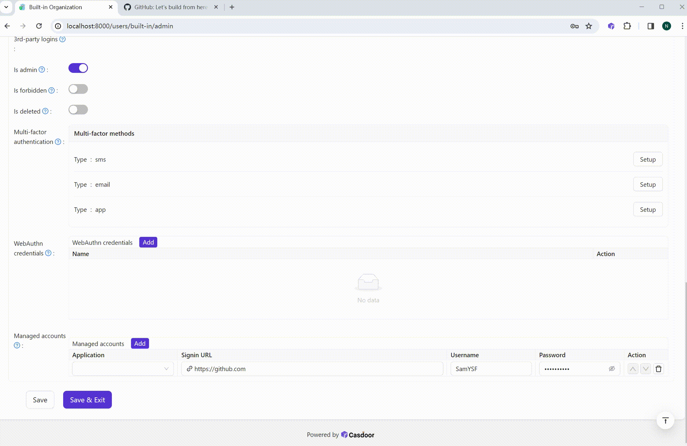

# casdoor-chrome-extension

The Casdoor browser extension signs users into the systems that have no single sign-on, by filling their sign-in forms with the accounts kept in [Casdoor](https://casdoor.ai). The code is open-sourced at: https://github.com/casdoor/casdoor-chrome-extension

## Demo video

## How it works

1. The admin turns on **Form autofill** in the application of a legacy system (the "Form autofill" tab of the application's edit page) and enters its sign-in page URLs, e.g. `https://oa.example.com/login`. The host must be the same, `*.example.com` covers its subdomains, and a path without `*` matches as a prefix. The fields are found automatically, or set with CSS selectors.
2. Each user's account of the system is a managed account on the user's page, or saved by the user: when **Let users save their accounts** is on, the extension offers to save the account that the user signs in with by hand.
3. When the user opens a sign-in page, the extension asks Casdoor for the account of that page and fills it in, and clicks the sign-in button when **Submit automatically** is on. A sign-in page that comes back within 30 seconds is filled but not submitted again.

Casdoor only hands an account out for a page of the system's own sign-in URLs, records every time it does, and can keep the passwords encrypted (the organization's "Encrypted fields", with `fieldEncryptionKey` set). Form autofill needs a Casdoor Enterprise edition license. On a Casdoor without it, the extension fills the managed accounts on the pages that match the application's "Signin URL", a regular expression, as its first versions did.

## Usage

### Install the extension

Install it from the [Chrome Web Store](https://chromewebstore.google.com/detail/casdoor-browser-plugin/bnjbegmkpjbcpneclidlbloadenondlm). It also works in Edge and other Chromium browsers that allow extensions from the Chrome Web Store.

Where the store can't be reached, download `casdoor-extension.zip` from the [latest release](https://github.com/casdoor/casdoor-chrome-extension/releases/latest), unzip it, go to `chrome://extensions`, turn on **Developer mode** in the top right, click **Load unpacked** and choose the unzipped folder.

Each release is published to the Chrome Web Store and attached to the GitHub release by `.github/workflows/release.yaml`, with the version of the release written into `manifest.json`. The store can take a few days to review a new version.

### Sign in to Casdoor

1. Open the extension, enter the Casdoor URL and the name of the application to sign in with.
2. Add the address shown at the bottom of the extension (`https://<extension id>.chromiumapp.org/`) to the redirect URLs of that application, and allow the `token` grant type in it. The extension installed from the Chrome Web Store always has the address `https://bnjbegmkpjbcpneclidlbloadenondlm.chromiumapp.org/`, so it can be added once for everyone; an unpacked one gets its own.
3. Click **Sign in to Casdoor**. The extension then lists the systems it fills for you.
