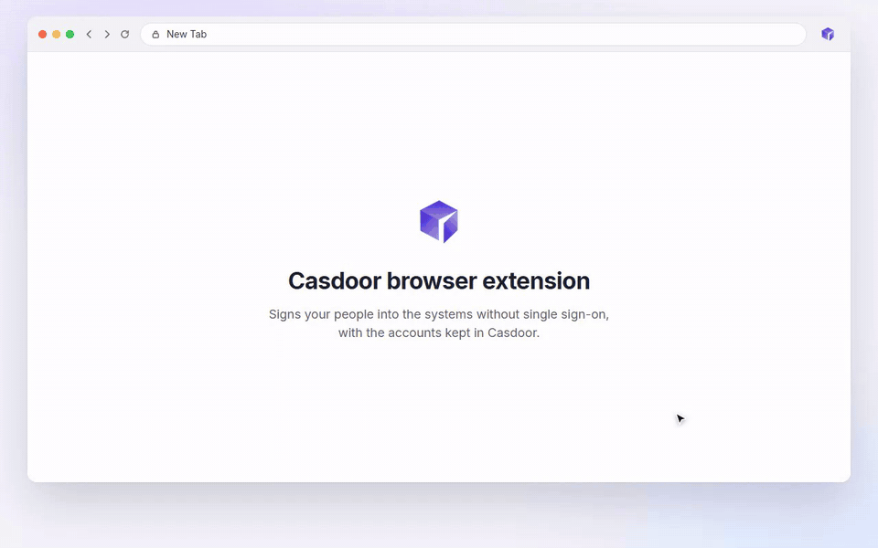

# Casdoor 浏览器扩展

[English](README.md) | 中文

[](https://chromewebstore.google.com/detail/casdoor-browser-plugin/bnjbegmkpjbcpneclidlbloadenondlm)
[](https://github.com/casdoor/casdoor-chrome-extension/actions/workflows/release.yml)
[](LICENSE)

Casdoor 浏览器扩展用来登录那些没有单点登录的系统，比如老的 OA、ERP 和内网网站：它用托管在 [Casdoor](https://casdoor.ai) 里的账号填写这些系统的登录表单。管理员在 Casdoor 里把每个系统配置一次，用户在扩展里登录一次 Casdoor，之后打开这些系统的登录页，扩展都会自动填好并登录。

[](docs/demo.mp4)

## 功能

- 填写系统登录页的用户名和密码；管理员开启“自动提交”时直接登录。
- 支持服务端渲染的表单、登录框晚出现或用 `#/login` 路由的单页应用、没有 `<form>` 的表单，以及嵌在 iframe 里的登录框。输入框自动识别，也可以由管理员指定 CSS 选择器。
- 一个系统有多个账号时让用户选，下次直接用选过的那个。
- 用扩展自带的模型在用户电脑上识别简单的图形验证码。验证码不对时换一张图重新识别，最多三次。密码被拒绝时不会重试，免得账号被锁。
- 管理员允许时，用户手动登录后提示把账号保存到 Casdoor，下次自动填写。
- 自动登录后 30 秒内又回到登录页的，只填写、不再提交，并提示用户。
- 弹窗里列出用户的系统，点一下就打开；关掉自动代填时，可以在当前页面手动填写一次。

## 安装

从 [Chrome 应用商店](https://chromewebstore.google.com/detail/casdoor-browser-plugin/bnjbegmkpjbcpneclidlbloadenondlm) 安装。支持 Chrome 116 及以上版本，以及能从 Chrome 应用商店装扩展的 Edge 等 Chromium 浏览器（Edge 提示时选择允许来自其他应用商店的扩展）。

打不开应用商店时：

1. 从 [最新发布](https://github.com/casdoor/casdoor-chrome-extension/releases/latest) 下载 `casdoor-extension.zip`，解压到一个不会被删掉的文件夹，浏览器每次启动都从这里加载扩展。
2. 打开 `chrome://extensions`（Edge 是 `edge://extensions`），打开右上角的“开发者模式”（Edge 叫“开发人员模式”）。
3. 点“加载已解压的扩展程序”（Edge 叫“加载解压缩的扩展”），选中这个文件夹，也就是里面有 `manifest.json` 的那一层。

这个包的 manifest 里带有应用商店版扩展的公钥，所以不管解压到哪里、装在哪台电脑上，扩展 ID 和回调地址都和商店版一样。之后要改装商店版的，先把它删掉，浏览器会把两者当成同一个扩展。升级时把新版本解压覆盖到同一个文件夹，再在 `chrome://extensions` 里点这个扩展的刷新按钮。

建议把扩展固定到工具栏（点工具栏上的拼图图标，再点 Casdoor 旁边的图钉），点一下就能打开弹窗。

## 使用

### 登录 Casdoor

点工具栏上的 Casdoor 按钮，填写“Casdoor 地址”（例如 `https://door.example.com`）和管理员告诉你的“应用”，点“用 Casdoor 登录”。会弹出一个 Casdoor 登录窗口，像平时一样登录就行（密码、验证码、扫码、第三方账号都可以），登录完窗口会自己关掉。

如果单位已经为浏览器设好了地址和应用，这两项会直接显示、不能修改，只需点“用 Casdoor 登录”。

登录后会一直保持，扩展在后台自动续期。在弹窗里点“退出”可以退出扩展；已经登录进去的系统不受影响。

### 我的系统

登录后，弹窗里的“我的系统”列出你能代填的系统：每个系统显示你在那里的账号，还没有账号的显示“登录时保存账号”。点一个系统会打开它的登录页。管理员新加了系统或账号后，点“刷新”。弹窗底部的链接打开你在 Casdoor 里的账号页面。

### 登录系统

像平时一样打开系统的登录页。扩展会填好用户名和密码，管理员开了“自动提交”的会直接登录；页面右上角会出现一张卡片，说明扩展做了什么。没开自动提交的，确认无误后点系统自己的登录按钮。

- **多个账号**：扩展会问用哪个账号，下次直接用选过的那个，不再问。
- **图形验证码**：管理员开启“识别图形验证码”后，扩展在你的电脑上识别验证码并填进去。识别错了会换一张图重新识别，最多三次；超过三次或者图片读不到时，会提示你手动输入。
- **密码不对**：系统拒绝了用户名或密码时，扩展会提示，并且不再重试，免得账号被锁。请管理员在 Casdoor 里改正这个账号。
- **又回到登录页**：自动登录后 30 秒内系统又显示登录页的，扩展只填写、不再提交，并提示你检查账号。

### 保存账号

管理员允许用户保存账号的系统，先手动登录一次。登录成功后扩展会问“把 XX 的账号保存到 Casdoor？”，点“保存”，以后就自动登录；点“暂不”就不保存。询问期间扩展最多保留这个密码两分钟，只有点了“保存”才会发给 Casdoor。

### 开关自动代填

弹窗里的“自动代填”开关可以在这个浏览器上关掉自动填写，比如要用别的账号登录某个系统时。当前标签页是你某个系统的登录页时，弹窗会显示这个系统和“立即填写”按钮，点一下填写一次，自动代填关着也能用。

## 在 Casdoor 里配置

表单代填是 Casdoor 企业版的功能。没有企业版 license 的 Casdoor 也能代填托管账户，见 [开源版](#开源版)。

1. **系统**：在每个系统对应的应用编辑页，打开“表单代填”页签，打开“开启表单代填”，填写它的“登录页地址”。按需要设置“自动提交”“允许用户保存账号”“识别图形验证码”；只有输入框识别不出来时才需要填 CSS 选择器。
2. **账号**：在用户详情页的“托管账户”里给每个用户配好这个系统的账号，或者让用户手动登录时自己保存。在组织的“企业合规”里设置加密存储后，密码加密保存。
3. **登录扩展**：用户填写 Casdoor 地址和本组织的一个应用：属于 `admin` 的应用直接写应用名，其他组织的应用写成 `组织名/应用名`。所有应用都默认接受应用商店版扩展的回调地址，不用另外配置。应用的“OAuth授权类型”要包含 `refresh_token`，否则访问令牌过期后用户要重新登录。自己构建、用开发者模式加载的版本有自己的回调地址，扩展会在登录表单下方显示，要加到应用的“重定向URLs”里；用 `--key` 构建的除外。

### 登录页地址

Casdoor 和扩展按同样的规则匹配地址：

| 地址 | 匹配 |
| --- | --- |
| `https://oa.example.com/login` | `https://oa.example.com/login`、`.../login?next=/` 和 `.../login.jsp`：不带 `*` 的路径按前缀匹配 |
| `oa.example.com/login` | 同一路径的 `http` 和 `https` |
| `*.example.com/signin` | `example.com` 所有子域名下的 `/signin` |
| `https://crm.example.com/*/login` | `*` 匹配路径里的任意内容 |
| `https://app.example.com/#/login` | 单页应用的 `#/login` 路由；只有地址里写了 `#` 时才比较 `#` 后面的部分 |

主机名必须相同，所以别的网站的页面不管地址里写了什么，都拿不到账号。

### 给整个单位部署

IT 可以用 Chrome 策略给所有浏览器安装扩展，并设好 Casdoor 地址和应用，用户不能修改。Windows 上的例子：

```reg
Windows Registry Editor Version 5.00

[HKEY_LOCAL_MACHINE\SOFTWARE\Policies\Google\Chrome\ExtensionInstallForcelist]
"1"="bnjbegmkpjbcpneclidlbloadenondlm"

[HKEY_LOCAL_MACHINE\SOFTWARE\Policies\Google\Chrome\3rdparty\extensions\bnjbegmkpjbcpneclidlbloadenondlm\policy]
"serverUrl"="https://door.example.com"
"application"="app-example"
```

`serverUrl` 和 `application` 这两项也可以通过 Google 管理控制台、macOS 配置描述文件或 Linux 策略文件下发，格式见 [public/managed_schema.json](public/managed_schema.json)。

不方便用 Chrome 策略的，可以预先配置好安装包再分发：解压发布里的 `casdoor-extension.zip`，填好根目录下的 `config.json`，把整个文件夹发给用户。用户用开发者模式加载后，地址和应用已经填好、不能修改，直接登录：

```json
{
  "serverUrl": "https://door.example.com",
  "application": "app-example"
}
```

这个包的扩展 ID 和应用商店版相同，Casdoor 直接接受它的回调地址。同时设了 Chrome 策略的，以策略为准。已经加载的文件夹里改了 `config.json` 后，要在 `chrome://extensions` 里点这个扩展的刷新按钮。

### 开源版

没有企业版 license 的 Casdoor，会把每个用户的托管账户填进对应应用的“登录URL”（按上面的登录页地址规则匹配）并提交。按登录页配置规则、CSS 选择器、识别验证码和保存账号需要企业版。

## 常见问题

| 现象 | 原因和处理 |
| --- | --- |
| Casdoor 提示回调地址不在允许列表里 | 这个扩展不是带应用商店公钥构建的，有自己的回调地址。改用应用商店版或发布里的安装包；或者把弹窗登录表单下方显示的地址加到应用的“重定向URLs”里。 |
| 弹窗提示没有这个应用 | 向管理员确认应用名；其他组织的应用要写成 `组织名/应用名`。 |
| 登录页上什么都没填 | 确认已经登录扩展、“自动代填”开着、这个系统出现在“我的系统”里。如果都没问题，可能是页面地址和这个系统的登录页地址对不上，请联系管理员。弹窗里的“立即填写”可以对当前页面试一次。 |
| 卡片提示管理员配置的输入框在页面上没找到 | 页面改版了，这次扩展已经自动识别了输入框。请管理员更新 CSS 选择器。 |
| 扩展又要求重新登录 | 登录已过期且没能续期。应用的“OAuth授权类型”要包含 `refresh_token`。 |
| 弹窗显示“基础代填” | 这个 Casdoor 没有企业版 license，见 [开源版](#开源版)。 |

## 隐私和安全

- 只有扩展的 service worker 和 Casdoor 通信、持有令牌。登录走 OAuth 授权码 + PKCE，在 Chrome 的窗口里完成，所以扩展没有 client secret，也看不到用户的 Casdoor 密码。令牌存在扩展的本地存储里，内容脚本读不到；退出时会在 Casdoor 里吊销。
- 只有页面自己的地址是这个系统的登录页时，才会拿到账号。Casdoor 在下发账号前会再核对一次地址，并记录每次下发。
- 扩展不保存密码。用户手动输入的账号，在扩展询问是否保存期间最多保留两分钟，只有用户同意才会发给 Casdoor。
- 验证码图片在用户电脑上识别，不会发到任何地方。在其他页面上，扩展不读取、也不发送任何内容。

隐私政策见 [casdoor.com/privacy](https://www.casdoor.com/privacy#browser-extension)。

## 开发

扩展用 TypeScript 编写、Vite 构建：弹窗是 React + Tailwind CSS，内容脚本和 service worker 是纯 TypeScript。

```bash
yarn install
yarn build        # 构建到 dist/，用“加载已解压的扩展程序”加载
yarn build --key  # 同上，但带应用商店的公钥，扩展 ID 和商店版相同
yarn watch        # 改动后自动重新构建
yarn typecheck
yarn test         # 登录页地址匹配的单元测试
```

| 目录 | |
| --- | --- |
| `src/background` | service worker：登录 Casdoor、系统和账号、验证码识别 |
| `src/content` | 内容脚本：查找和填写登录表单、页面上的卡片 |
| `src/popup` | 弹窗 |
| `src/offscreen` | 用 ONNX Runtime Web 识别验证码的页面 |
| `src/shared` | 各部分之间的消息、登录页地址匹配、类型定义 |
| `public` | manifest 的多语言文案、图标、策略格式、验证码模型、`config.json` |
| `e2e` | 端到端测试、测试用的模拟系统、演示视频的录制脚本 |

### 端到端测试

端到端测试用 Playwright 在 Chromium 里加载扩展，通过一个带企业版 license 的真实 Casdoor 登录四个模拟系统（`e2e/systems.mjs`）：

1. 在 `http://localhost:18100` 运行一个 Casdoor，`app.conf` 里设 `origin = http://door.acme.test`。
2. 运行测试，它会先在这个 Casdoor 里建好组织、用户和系统：

```bash
yarn build --e2e
CASDOOR_ADMIN_PASSWORD=<admin 的密码> node e2e/run.mjs
```

`node e2e/demo/record.mjs` 在同样的环境里录制 [docs/demo.mp4](docs/demo.mp4) 和 [docs/demo.gif](docs/demo.gif)，需要 ffmpeg。

### 发布

`master` 上的每个提交都由 semantic-release 按提交信息（`feat:`、`fix:`）决定版本号并发布。发布流程把版本号写进 manifest，把带应用商店公钥的 `casdoor-extension.zip` 附到 GitHub Release 上，再把不带公钥的同一构建提交到 Chrome 应用商店，审核通过后上架。

## 许可证

[Apache-2.0](LICENSE)。验证码模型来自 [ddddocr](https://github.com/sml2h3/ddddocr)，运行在 [ONNX Runtime Web](https://github.com/microsoft/onnxruntime) 上，两者都是 MIT 许可证。
